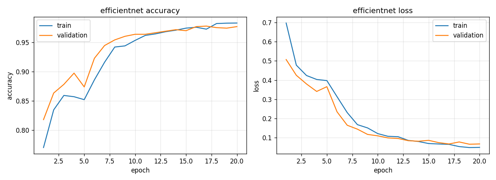
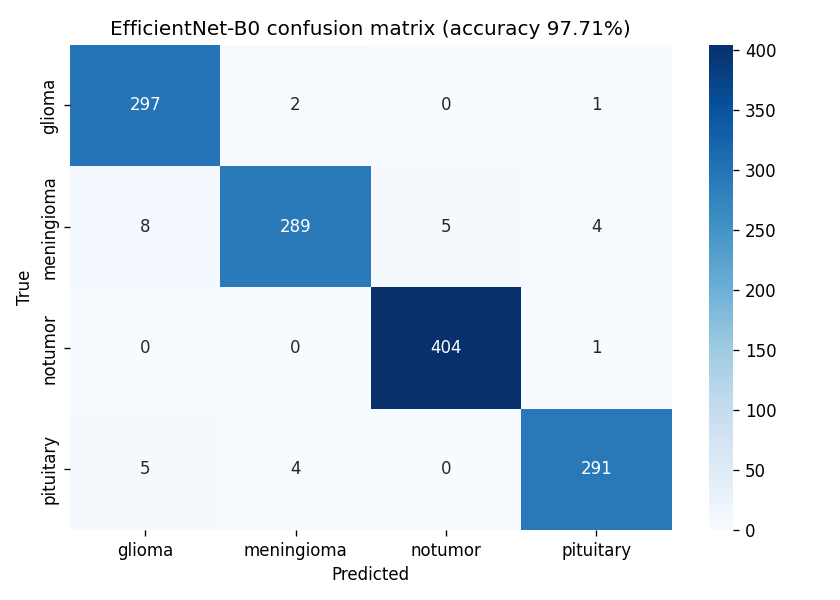
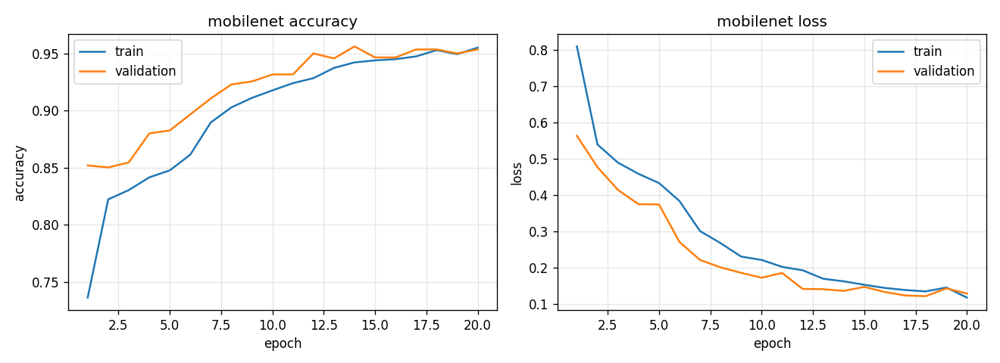
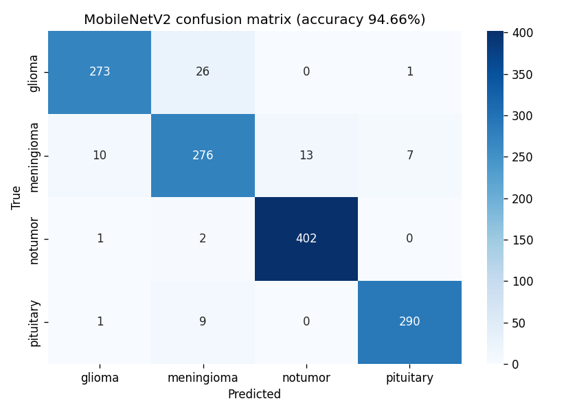
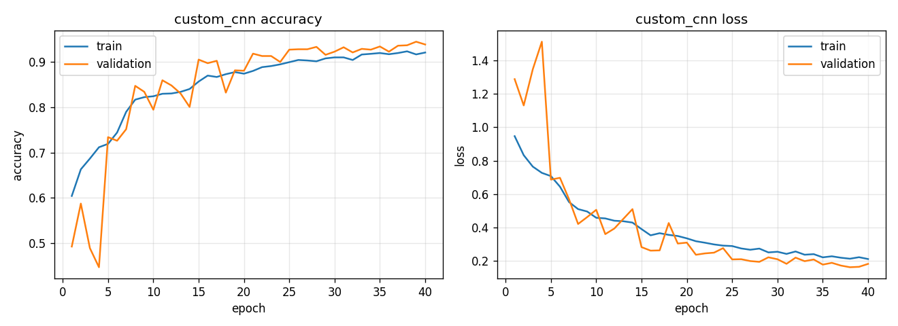

# Brain Tumor MRI Image Classification

Deep-learning project (PyTorch) that classifies brain MRI images into four classes:

| Class | Meaning |
|---|---|
| `glioma` | Glioma tumour |
| `meningioma` | Meningioma tumour |
| `notumor` | No tumour |
| `pituitary` | Pituitary tumour |

It includes a **custom CNN built from scratch**, **transfer learning** with ImageNet-pretrained
models (EfficientNet-B0, MobileNetV2, ResNet50), full evaluation and comparison, and a
**Streamlit web app** for real-time predictions on uploaded MRI images.

> Educational project — not a medical device and not a substitute for a radiologist.

## Results

Evaluated on the held-out **Testing** set (1,311 images).

| Model | Accuracy | Precision | Recall | F1 | Params | Size | Inference* |
|---|---|---|---|---|---|---|---|
| **EfficientNet-B0** (best) | **97.71%** | 0.977 | 0.977 | 0.977 | 4.0M | 16.3 MB | 4.1 ms |
| MobileNetV2 | 94.66% | 0.947 | 0.947 | 0.947 | 2.2M | 9.2 MB | 2.9 ms |
| Custom CNN | 92.75% | 0.927 | 0.928 | 0.927 | 1.2M | 4.9 MB | 11.8 ms |

\*Per image, batch of 32 on an Apple M2 GPU, measured while other jobs were running — treat as a rough comparison.

**Model choice:** EfficientNet-B0 is the most accurate on every class and is still small and fast, so the
Streamlit app uses it by default. MobileNetV2 is the lightest pretrained option; the Custom CNN, trained from
scratch with ~1.2M parameters, reaches 92.75% and shows how much ImageNet pretraining adds (+5 points).

Per-class F1 on the test set:

| Class | EfficientNet-B0 | MobileNetV2 | Custom CNN |
|---|---|---|---|
| glioma | 0.974 | 0.933 | 0.920 |
| meningioma | 0.962 | 0.892 | 0.850 |
| notumor | 0.993 | 0.980 | 0.961 |
| pituitary | 0.975 | 0.970 | 0.966 |

Meningioma is the hardest class for every model. For the Custom CNN, the most common error is glioma
predicted as meningioma (32 images); EfficientNet-B0 reduces that to 2.

### EfficientNet-B0




### MobileNetV2




### Custom CNN




## Project Layout

```text
brain-tumor-classification/
├── data/                       # dataset (not committed)
│   ├── Training/{glioma,meningioma,notumor,pituitary}/
│   └── Testing/{glioma,meningioma,notumor,pituitary}/
├── models/                     # trained weights, histories, plots, comparison
├── notebooks/
│   └── exploration.ipynb       # dataset exploration (EDA)
├── src/
│   ├── data_preprocessing.py   # resizing, normalisation, augmentation, data loaders
│   ├── training.py             # training loop: ModelCheckpoint, EarlyStopping, history plots
│   ├── custom_cnn.py           # custom CNN model + training script
│   ├── transfer_learning.py    # pretrained models + two-stage fine-tuning script
│   ├── model_registry.py       # build/load any trained model by name
│   ├── evaluation.py           # test-set metrics, confusion matrices, model comparison
│   ├── model_quality.py        # quick balanced-sample evaluation (used by the app)
│   └── app.py                  # Streamlit application
└── requirements.txt
```

## Workflow

1. **Dataset understanding** — `notebooks/exploration.ipynb`: class counts and balance, sample
   images, image resolutions and colour modes, pixel-intensity distribution, augmentation preview.
2. **Preprocessing** — images are converted to RGB, resized to 224×224, scaled to 0–1 and normalised
   with ImageNet mean/std. 20% of `Training/` is held out (fixed seed) as a validation set;
   `Testing/` is only used for the final evaluation.
3. **Augmentation** — random crop/zoom, horizontal and vertical flips, rotation, shifts, and
   brightness/contrast jitter (training set only).
4. **Custom CNN** — 4 convolutional blocks (32→64→128→256 filters, two conv layers each, with
   batch normalisation and ReLU, then max pooling), global average pooling, and a dense head with
   dropout. ~1.2M parameters.
5. **Transfer learning** — ImageNet-pretrained backbone with a new 4-class head. Stage 1 trains
   only the head with the backbone frozen; stage 2 unfreezes the top backbone layers and fine-tunes
   with a 10× lower learning rate.
6. **Training** — AdamW, cross-entropy loss, `ReduceLROnPlateau`, **ModelCheckpoint** (keeps the
   epoch with the lowest validation loss) and **EarlyStopping**. Training/validation accuracy and
   loss are saved to `models/<model>_history.json` and plotted to `models/<model>_history.png`.
7. **Evaluation** — accuracy, precision, recall, F1 (per class and weighted) and confusion matrices
   on the test set.
8. **Model comparison** — `models/comparison.csv` compares accuracy, F1, model size and inference
   speed; the best model is used by default in the app.
9. **Deployment** — Streamlit app with image upload, predicted tumour type, confidence score,
   per-class probabilities, model selector and model comparison.

## Setup

```bash
python3 -m venv venv
source venv/bin/activate
pip install --upgrade pip
pip install -r requirements.txt
```

Place the dataset in `data/Training` and `data/Testing`, one sub-folder per class (see layout above).

Training automatically uses an NVIDIA GPU (CUDA) or Apple Silicon GPU (MPS) when available.

## Usage

Run the commands from the project root.

```bash
# 1. Train the custom CNN               -> models/custom_cnn.pth
python src/custom_cnn.py

# 2. Train transfer-learning models     -> models/efficientnet.pth, models/mobilenet.pth, ...
python src/transfer_learning.py efficientnet mobilenet   # or no arguments for all three

# 3. Evaluate and compare on the test set -> models/comparison.csv, *_cm.png, *_report.json
python src/evaluation.py

# 4. Launch the web app
streamlit run src/app.py
```

The first transfer-learning run downloads the ImageNet weights.

## Notes

- Models are saved as PyTorch `.pth` state dicts (the PyTorch equivalent of Keras `.h5` files).
- `models/resnet50.pth` (~95 MB) is excluded from git; the other checkpoints are committed.
